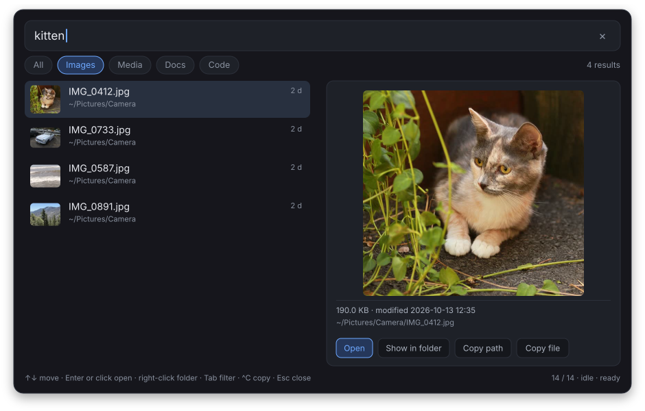
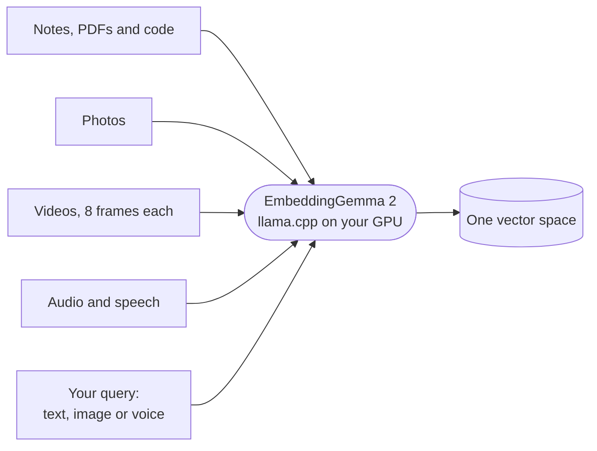
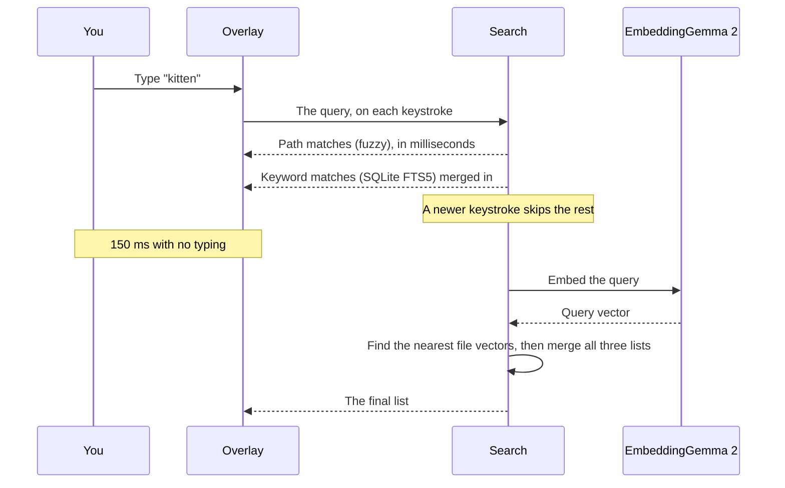
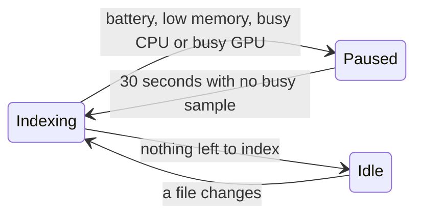
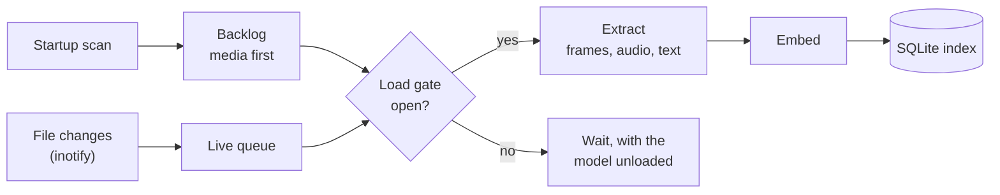

<h1 align="center">mmsearch</h1>

<p align="center">
  <b>Search your files by what they contain, not only by their names.</b><br>
  A local, multimodal search overlay for Wayland.
</p>

<p align="center">
  
  
  
  
</p>

<p align="center">
  
</p>

<p align="center">
  <a href="assets/demo.mp4"><b>Watch the demo video (34 s)</b></a>: six searches find photos, a video, a speech, an invoice and code by what they contain.
</p>

Press a key and type what you remember. mmsearch finds a photo from what it shows, a video from its frames, a voice memo from what someone says in it, and a note from what it means. The file name does not have to match. You can also search with an image or with your voice.

Everything runs on your machine. The model runs on your GPU, the index stays in your home directory, and no file leaves your computer.

## Contents

- [Features](#features)
- [Examples](#examples)
- [Requirements](#requirements)
- [Install](#install)
- [Set up](#set-up)
- [Use the overlay](#use-the-overlay)
- [Use the command line](#use-the-command-line)
- [How it works](#how-it-works)
- [Files and privacy](#files-and-privacy)
- [Troubleshooting](#troubleshooting)
- [Limits](#limits)
- [Development](#development)
- [Credits](#credits)

## Features

- **Search by meaning.** Type "a cat in the garden" and get the cat photo named `IMG_0412.jpg`.
- **Every kind of file in one list.** Photos, videos, audio, PDFs, notes and source code share one ranked result list.
- **Three ways to ask.** Type text, paste or capture an image, or hold a key and speak.
- **Instant first results.** Path matches show in milliseconds. Keyword and meaning matches join a moment later.
- **Keyboard or mouse.** Point and click to open, scroll and drag through hundreds of results, and edit the query like any text field.
- **Always up to date.** The daemon watches your files and indexes changes as they happen.
- **Stays out of your way.** Indexing pauses on battery and when a game or a build loads the machine. The model also leaves the GPU, so the game gets its VRAM back.
- **One binary.** The model runs inside the daemon through llama.cpp and Vulkan. There is no Python, no server and no cloud API.

## Examples

These are real results from the files in [`tests/fixtures`](tests/fixtures). None of the file names contain a word of the query.

| You search for | mmsearch finds | Why it matches |
|---|---|---|
| `kitten` | `Pictures/Camera/IMG_0412.jpg` | The photo shows a kitten. |
| `sea turtle` | `Videos/clip_01.mp4` | The video frames show a sea turtle. |
| `ask not what your country can do for you` | `Music/voice-memos/recording_01.wav` | The recording is a speech with these words. |
| `how much do I owe the plumber` | `Documents/bills/invoice.pdf` | The PDF is a plumber's invoice. |
| `trip to portugal` | `Documents/notes/lisbon.md` | The note plans days in Lisbon. |
| a photo of a different kitten | `Pictures/Camera/IMG_0412.jpg` | The two photos show similar things. |
| a 4-second voice clip | `Music/voice-memos/recording_01.wav` | The clip comes from that recording. |

## Requirements

- **A Wayland compositor with layer-shell support,** for example niri, Hyprland, sway, river or KDE Plasma. GNOME Shell does not support layer-shell, so the overlay cannot open there. I test mmsearch on niri.
- **A GPU with a Vulkan driver.** The model uses about 2.3 GB of VRAM while it is loaded. Without Vulkan, llama.cpp runs on the CPU, which is much slower.
- **About 900 MB of disk for the model,** plus space for the index. One home directory with 214,703 indexed files gave an 8.3 GB index.
- **A network connection on the first start only.** The daemon downloads the model from Hugging Face once.

## Install

### With Nix

To try mmsearch without an install, run the daemon in one terminal:

```sh
nix run github:0xPD33/mmsearch -- daemon
```

Then open the overlay from another terminal:

```sh
nix run github:0xPD33/mmsearch -- toggle
```

On NixOS, add the flake to your system flake:

```nix
# flake.nix
inputs.mmsearch.url = "github:0xPD33/mmsearch";
```

```nix
# configuration.nix
{ inputs, pkgs, ... }:
let
  mmsearch = inputs.mmsearch.packages.${pkgs.stdenv.hostPlatform.system}.default;
in
{
  environment.systemPackages = [ mmsearch ];
  # The package ships a systemd user unit. This starts it with your graphical session.
  systemd.packages = [ mmsearch ];
  systemd.user.services.mmsearch.wantedBy = [ "graphical-session.target" ];
}
```

On another Linux distribution with Nix:

```sh
nix profile add github:0xPD33/mmsearch   # older Nix: nix profile install
systemctl --user enable --now ~/.nix-profile/lib/systemd/user/mmsearch.service
```

The Nix package puts all the runtime tools on the daemon's `PATH`. You do not have to install them.

### Prebuilt binary

Each [release](https://github.com/0xPD33/mmsearch/releases) has a binary for x86_64 Linux. It needs glibc 2.39 or newer: Ubuntu 24.04, Debian 13, Fedora 40, Arch Linux, Omarchy, or newer. It runs on any 64-bit x86 CPU.

Install the runtime programs first. On Arch Linux and Omarchy:

```sh
sudo pacman -S --needed vulkan-icd-loader alsa-lib ffmpeg poppler curl xdg-utils wl-clipboard slurp libnotify
```

On Ubuntu and Debian:

```sh
sudo apt install libvulkan1 libasound2t64 ffmpeg poppler-utils curl xdg-utils wl-clipboard slurp libnotify-bin
```

Then download the binary and start the daemon with your session:

```sh
curl -LO https://github.com/0xPD33/mmsearch/releases/download/v0.1.0/mmsearch-v0.1.0-x86_64-linux.tar.gz
tar xzf mmsearch-v0.1.0-x86_64-linux.tar.gz
cd mmsearch-v0.1.0-x86_64-linux
install -Dm755 mmsearch ~/.local/bin/mmsearch
install -Dm644 mmsearch.service ~/.config/systemd/user/mmsearch.service
systemctl --user enable --now mmsearch
```

Make sure that `~/.local/bin` is in your `PATH`, so that your compositor key binding finds `mmsearch toggle`.

### From source

You need these build dependencies:

- A recent stable Rust (the repository pins 1.97.1)
- A C and C++ compiler, cmake and pkg-config
- libclang, for the llama.cpp bindings
- shaderc (`glslc`), Vulkan headers and SPIR-V headers
- The development files for wayland, libxkbcommon and alsa-lib

On Arch Linux and Omarchy:

```sh
sudo pacman -S --needed base-devel rustup git cmake pkgconf clang shaderc vulkan-headers vulkan-icd-loader spirv-headers wayland libxkbcommon alsa-lib
sudo pacman -S --needed ffmpeg poppler curl xdg-utils wl-clipboard slurp libnotify
rustup default stable
```

On Ubuntu 24.04 and Debian. The `rustc` package is too old, so install Rust with [rustup](https://rustup.rs):

```sh
sudo apt install build-essential curl git cmake pkg-config clang libclang-dev glslc libvulkan-dev spirv-headers libwayland-dev libxkbcommon-dev libasound2-dev
sudo apt install ffmpeg poppler-utils xdg-utils wl-clipboard slurp libnotify-bin
curl -sSf https://sh.rustup.rs | sh
```

Then build and install mmsearch to `~/.cargo/bin`. The first build takes several minutes, because it compiles llama.cpp and its Vulkan shaders.

```sh
cargo install --locked --git https://github.com/0xPD33/mmsearch --tag v0.1.0
```

Both lists were tested in clean Arch Linux and Ubuntu 24.04 containers: the build, an index of the test files, the queries, and the overlay in a headless sway session.

The daemon calls these programs at runtime. The second command of each list above installs them:

| Program | Used for |
|---|---|
| `ffmpeg`, `ffprobe` | Video frames and audio |
| `pdftotext` (poppler) | PDF text |
| `curl` | The first model download |
| `xdg-open` (xdg-utils), `setsid` (util-linux) | Opening files |
| `busctl` (systemd) | Showing a file in its folder |
| `wl-copy`, `wl-paste` (wl-clipboard) | Copying paths and pasting images |
| `slurp` | Selecting a screen region |
| `notify-send` (libnotify) | Errors from `mmsearch toggle` |

Then add a systemd user unit, so the daemon starts with your session:

```sh
mkdir -p ~/.config/systemd/user
cat > ~/.config/systemd/user/mmsearch.service <<'EOF'
[Unit]
Description=mmsearch multimodal search daemon
PartOf=graphical-session.target
After=graphical-session.target
ConditionEnvironment=WAYLAND_DISPLAY

[Service]
ExecStart=%h/.cargo/bin/mmsearch daemon
Restart=on-failure
RestartSec=3

[Install]
WantedBy=graphical-session.target
EOF
systemctl --user enable --now mmsearch
```

## Set up

### 1. Bind a key

Bind `mmsearch toggle` to a free key in your compositor. These examples use `Mod+Space`.

niri, in `~/.config/niri/config.kdl`:

```kdl
binds {
    Mod+Space { spawn "mmsearch" "toggle"; }
}
```

Hyprland, in `~/.config/hypr/hyprland.conf`:

```ini
bind = SUPER, SPACE, exec, mmsearch toggle
```

sway, in `~/.config/sway/config`:

```
bindsym $mod+space exec mmsearch toggle
```

### 2. Let the first index run

On the first start, the daemon does these steps:

1. It downloads the model files (about 865 MB) to `~/.local/share/mmsearch/models/`.
2. It walks your home directory and lists the files for path search.
3. It indexes the contents: images, video and audio first, then documents and code.

Path search works at once. Meaning search finds more files as the index grows. To see the progress, run:

```console
$ mmsearch status
index:  14320 / 157004 · indexing
model:  ready
```

The overlay shows the same line in its bottom right corner.

## Use the overlay

Press your key, type, and press `Enter` or click a result to open it.

Results show in steps: path matches at once, keyword matches a moment later, and meaning matches after a 150 ms pause in typing. Each row shows a thumbnail or a file-type badge, the folder, and when the file changed. The preview pane shows the image, the video poster frame, or the best text passage. You can scroll through all results, up to 600.

You can combine text with an image. For example, paste a photo of a car and type "at night".

### Keyboard

| Key | Action |
|---|---|
| `↑` `↓`, `Ctrl+J` `Ctrl+K` | Move the selection. |
| `PgUp` `PgDn` | Move one screen. |
| `Ctrl+Home` `Ctrl+End` | Go to the first or the last result. |
| `Enter` | Open the file in its default app. |
| `Ctrl+Enter` | Show the file in your file manager. |
| `Tab`, `Shift+Tab` | Change the filter: All, Images, Media, Docs, Code. |
| `Ctrl+1` … `Ctrl+5` | Pick a filter directly. |
| `Ctrl+C` | Copy the selected query text. With no text selected, copy the path of the file. |
| `Ctrl+Shift+C` | Copy the file itself: image data for an image, a file link for anything else. |
| `Ctrl+V` | Paste an image from the clipboard as a query. Text pastes at the caret. |
| `Ctrl+S` | Select a region of the screen and search with it. |
| Hold `Ctrl+Space` | Record a voice query, up to 30 seconds. Release to search. |
| `Ctrl+=` `Ctrl+-` `Ctrl+0` | Make the overlay bigger, smaller, or the default size. |
| `Esc` | Close the overlay. |

The search field edits like any text field:

| Key | Action |
|---|---|
| `←` `→`, `Home` `End` | Move the caret. Add `Shift` to select. |
| `Ctrl+←` `Ctrl+→` | Move by word. |
| `Backspace` `Delete` | Delete a character. With `Ctrl`, delete a word. |
| `Ctrl+A` | Select all. |
| `Ctrl+X` | Cut the selected text. |
| `Ctrl+Z`, `Ctrl+Shift+Z` or `Ctrl+Y` | Undo, redo. |
| `Ctrl+W`, `Ctrl+U` | Delete the word before the caret, clear the query. |
| `Backspace` on an empty query | Remove the image or voice query. |

### Mouse

| Action | Result |
|---|---|
| Point at a result | Select it and show its preview. |
| Click a result, or the preview | Open the file. |
| Right-click a result | Show the file in your file manager. |
| Wheel | Scroll the results. Over the preview, scroll the preview text. |
| Drag the scrollbar | Scroll fast through long result lists. |
| Click the buttons under the preview | Open, show in folder, copy the path, copy the file. |
| Click the filter chips | Change the filter. |
| Click, drag or double-click in the search field | Place the caret, select text, select a word. |
| Click the × in the search field | Clear the query. |
| Click an attached image or voice chip | Remove it. |
| Click an example in the empty overlay | Search for it. |

## Use the command line

`mmsearch query` searches the index without the overlay. It works while the daemon runs, and it does not need one.

```console
$ mmsearch query "how much do I owe the plumber" --limit 5
0.0164  pdf     /home/you/Documents/bills/invoice.pdf
0.0161  text    /home/you/Documents/notes/sprint-planning.md
0.0159  code    /home/you/dev/settings-kit/scripts/helper.py
0.0156  text    /home/you/Documents/notes/houseplants.md
0.0154  image   /home/you/Pictures/Camera/IMG_0587.jpg
```

Search with an image or a sound file:

```console
$ mmsearch query --image ~/Downloads/another-kitten.jpg --limit 3
0.0164  image   /home/you/Pictures/Camera/IMG_0412.jpg
0.0161  image   /home/you/Pictures/Camera/IMG_0587.jpg
0.0159  image   /home/you/Pictures/Camera/IMG_0891.jpg

$ mmsearch query --audio ~/clip.wav --limit 3
0.0164  audio   /home/you/Music/voice-memos/recording_01.wav
0.0161  text    /home/you/Documents/notes/sprint-planning.md
0.0159  image   /home/you/Pictures/Camera/IMG_0891.jpg
```

The score is a rank fusion value, not a similarity. A higher score is better. The meaning matcher always returns its nearest files, so the lower rows of a small index are weak matches.

All commands:

| Command | Action |
|---|---|
| `mmsearch daemon` | Run the indexer, search and the overlay. |
| `mmsearch toggle` | Open or close the overlay. |
| `mmsearch status [--json]` | Show the index progress and the model state. |
| `mmsearch query [TEXT] [--image F] [--audio F] [--limit N] [--json]` | Search without the overlay. |
| `mmsearch index --root DIR [--db FILE]` | Index one directory once, with no load checks. |
| `mmsearch embed [--prompt P] [--media F]...` | Print the vector of one input as JSON. |

`mmsearch status --json` gives a status bar the same data:

```console
$ mmsearch status --json
{"indexed":14,"model":"ready","phase":"idle","total":14}
```

For example, a Waybar module:

```json
"custom/mmsearch": {
  "exec": "mmsearch status --json | jq -r .phase",
  "interval": 10
}
```

## How it works

### One model for every kind of file

mmsearch uses [EmbeddingGemma 2](https://huggingface.co/google/embeddinggemma-2) from Google. The model turns text, code, images, video frames and audio into vectors in one shared space. A photo of a cat and the words "a cat" get vectors that are close together. A search finds the files whose vectors are closest to the vector of your query.



The daemon runs the model in-process through llama.cpp with Vulkan. Your query and your files go through the same model, so a text query can find an image and an image query can find a video.

### Three matchers, one list

Each query runs three matchers. Their lists merge into one with Reciprocal Rank Fusion. A file that ranks high in more than one list goes to the top. The fast matchers answer first, so the list never waits for the slow ones.



- **Path:** a fuzzy match on every file path in your home directory.
- **Keyword:** a full-text match with BM25 ranking on the text of documents, notes and code.
- **Meaning:** the nearest vectors to the query vector, from all indexed files.

### Indexing that stays out of your way

The daemon indexes all the time, so new photos become searchable soon after you save them. A sampler checks the machine every 2 seconds. When the machine is busy, indexing stops and the model leaves the GPU.



The gate closes when one of these conditions is true:

- The machine runs on battery.
- Less than 15% of the memory is available.
- Other processes use more than 50% of all CPU cores.
- Other processes use more than 33% of an NVIDIA GPU. The compositor does not count.

While the gate is closed, the model is unloaded and only your searches load it again. The status shows the reason, for example `paused (gpu busy)`.



### What gets indexed

| Kind | What mmsearch reads |
|---|---|
| Images | The picture itself. Images smaller than 64 px are skipped. |
| Video | 8 frames, evenly spaced. A file with no video stream counts as audio. |
| Audio | The first 5 minutes of sound. |
| PDF | The text of the first 50 pages. |
| Text | The text, in chunks of about 500 tokens. Files larger than 1 MB are skipped. |
| Code | All the text for keyword search, and the start of the file for meaning search. Files larger than 1 MB are skipped. |
| JSON, YAML, TOML | The text, for keyword search only. |
| Everything else | The path only. |

mmsearch indexes the contents of your home directory. It skips these:

- Hidden directories and the files in `.gitignore`
- `node_modules`, `venv`, `.venv`, `site-packages` and `__pycache__`
- Build output in `target`, `dist` and `build`
- Android SDK trees in `Sdk`

Path search covers more: it also lists build output, `venv` directories and SDK trees, unless `.gitignore` excludes them. It also includes `~/.config` and hidden files, such as `~/.zshrc`. It skips the other hidden directories, `.git` and `node_modules`. In one home directory, hidden directories held 73% of all paths, mostly game files and package caches. mmsearch does not follow symlinks or enter other file systems, such as network mounts.

## Files and privacy

mmsearch makes one network connection: the first model download from Hugging Face. Nothing else leaves your machine.

| Path | Contents |
|---|---|
| `~/.local/share/mmsearch/index.db` | The index: paths, extracted text and vectors. Mode 0600. |
| `~/.local/share/mmsearch/models/` | The model files. |
| `~/.cache/thumbnails/` | Thumbnails of images and videos, shared with your file manager. |
| `$XDG_RUNTIME_DIR/mmsearch.sock` | The control socket. Only your user can open it. |

The index holds text from your documents, so treat it like the documents themselves. To delete the index, stop the daemon and remove the database files:

```sh
systemctl --user stop mmsearch
rm ~/.local/share/mmsearch/index.db*
systemctl --user start mmsearch
```

## Troubleshooting

**`mmsearch toggle` says `no daemon at ...`.** The daemon does not run. Start it with `systemctl --user start mmsearch`, and read its log with `journalctl --user -u mmsearch`.

**The overlay does not open.** Your compositor must support the layer-shell protocol. GNOME Shell does not support it.

**The status shows `paused (...)`.** This is normal while a game, a build or a battery runs the machine. Indexing continues 30 seconds after the load ends. Searches still work.

**Meaning search finds nothing.** Run `mmsearch status`. If the model line shows `failed: ...`, the model did not load or download. Path and keyword search still work.

**Indexing is very slow.** llama.cpp runs on the CPU if Vulkan fails. Look for Vulkan errors in `journalctl --user -u mmsearch`.

## Limits

- No OCR. Text inside images is not searchable as text.
- No Office or EPUB documents.
- Video indexing uses the frames only, not the sound track.
- Audio indexing uses the first 5 minutes only.
- The GPU load check works with NVIDIA GPUs only. On other GPUs, only the battery, memory and CPU checks pause indexing.
- The vector search scans every vector. It stays fast up to about 2 million vectors.
- No X11 and no GNOME Shell.

## Development

```sh
nix develop
cargo build --release
tests/e2e.sh
```

`tests/e2e.sh` indexes the fixtures, runs fixed text, image and audio queries, and checks that each expected file is in the top 3. It writes `tests/report/e2e-report.html` with the results and their thumbnails.

[`DESIGN.md`](DESIGN.md) describes the architecture, the index format and the reasons for each decision.

## Credits

- [EmbeddingGemma 2](https://huggingface.co/google/embeddinggemma-2) by Google, Apache 2.0. mmsearch downloads the GGUF files from [ggml-org/embeddinggemma-2-GGUF](https://huggingface.co/ggml-org/embeddinggemma-2-GGUF).
- [llama.cpp](https://github.com/ggml-org/llama.cpp) runs the model. mmsearch uses the `llama-cpp-sys-2` bindings from [llama-cpp-rs](https://github.com/utilityai/llama-cpp-rs), through [a fork](https://github.com/0xPD33/llama-cpp-rs/tree/embeddinggemma2) with a newer llama.cpp until a release supports EmbeddingGemma 2.
- The overlay uses [a winit fork](https://github.com/SergioRibera/winit) with layer-shell support, [wgpu](https://github.com/gfx-rs/wgpu) and [glyphon](https://github.com/grovesNL/glyphon).
- The test fixtures are CC0 or public domain. [`tests/fixtures/SOURCES.txt`](tests/fixtures/SOURCES.txt) lists each source.

## License

MIT. See [LICENSE](LICENSE).
